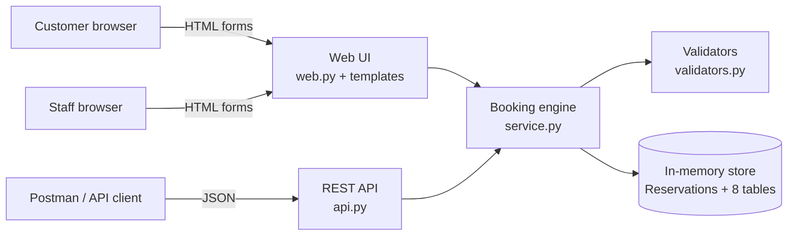
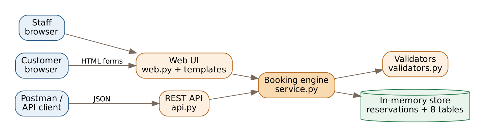

# Test Plan – Restaurant Table Reservation System

| Item | Detail |
|---|---|
| Document ID | TP-RTRS-01 |
| Version | 1.0 |
| Application | Restaurant Table Reservation System v1.0 ("The Saffron Table") |
| Prepared by | Roshna Sai (1MS23IS106) |
| Standard followed | Structure based on IEEE 829 test plan |

---

## 1. Introduction

The Restaurant Table Reservation System lets customers book a table online and lets restaurant staff manage the day's bookings. This plan describes **what** will be tested, **how** it will be tested, **who** does it, and **when testing is finished**.

In plain words: a restaurant has a fixed number of tables. The system must never give the same table to two groups at the same time, must refuse bad input (a wrong phone number, 0 guests, a date in the past), must charge the right deposit, and must move each booking through its life cycle correctly (booked → seated → completed, or cancelled / no-show).

## 2. Application understanding

### 2.1 Architecture

### 2.2 Modules and functionalities to be tested

| # | Module | Functionalities |
|---|---|---|
| M1 | Customer input validation | Name, mobile number, email, party size, date, time slot |
| M2 | Table allocation | Find smallest free table that fits; 90-minute hold; prevent double booking; "no table" handling |
| M3 | Deposit calculation | Large-party deposit, weekend-peak deposit, combined deposit |
| M4 | Reservation life cycle | Seat, complete, no-show, cancel; block invalid status changes |
| M5 | Cancellation & refund | Refund deposit only when cancelled 2+ hours ahead |
| M6 | Duplicate prevention | One active booking per phone number per day |
| M7 | REST API | Status codes, JSON responses, error messages |
| M8 | Web UI | Booking form, confirmation page, staff view, error display |

### 2.3 Requirements (the test basis)

| ID | Requirement |
|---|---|
| R1 | Customer name is required: **2–50 characters**, letters and spaces only (leading/trailing spaces ignored). |
| R2 | Mobile number: **exactly 10 digits**, first digit **6, 7, 8 or 9**. |
| R3 | Email is optional; if entered it must be a valid email format. |
| R4 | Party size: whole number from **1 to 8**. |
| R5 | Booking date: from **today** up to **30 days ahead** (inclusive). |
| R6 | Time slot: **11:00 to 21:30**, only at :00 or :30, and not already passed. |
| R7 | The system assigns the **smallest free table** that seats the party. A booking holds the table for **90 minutes**. Two active bookings must **never overlap** on the same table. If no table fits, the booking is refused. |
| R8 | Deposit: parties of **6+** pay **₹100 per guest**. **Saturday/Sunday** bookings at **19:00–21:30** pay **₹300**. If both apply, both are added. Otherwise no deposit. |
| R9 | Status life cycle: CONFIRMED → SEATED → COMPLETED; CONFIRMED → CANCELLED; CONFIRMED → NO_SHOW. No other change is allowed. |
| R10 | Cancelling **2 hours or more** before the slot refunds the full deposit; later cancellations forfeit it. Only CONFIRMED bookings can be cancelled. |
| R11 | A phone number may hold only **one active booking per day**. |
| R12 | The API returns 201 on create, 400 for invalid input, 404 for unknown IDs, 409 for rule conflicts. |
| R13 | The web form shows a clear error message and **keeps what the user typed** when a booking is rejected. |

Table layout: T1 (2), T2 (2), T3 (4), T4 (4), T5 (4), T6 (6), T7 (6), T8 (8) – 8 tables, 36 seats.

## 3. Scope

**In scope:** all functions in modules M1–M8 above, at unit, API (integration) and UI (system) level.

**Out of scope:** payment gateway (deposits are only calculated, not charged), SMS/email notifications, user login, load/performance testing, security penetration testing, mobile apps, data persistence across restarts (the app keeps data in memory).

## 4. Test approach

| Level | What is tested | How | Tool |
|---|---|---|---|
| Unit | Validators, deposit rule, overlap logic, status rules | Automated | **pytest** |
| Integration / API | REST endpoints, status codes, JSON | Automated | **pytest + Flask test client**, **Postman / Newman** |
| System / UI | Booking flow in a real browser | Automated | **Selenium WebDriver** (Chrome, headless) |
| Test quality | How strong the unit tests are | Automated | **Mutation testing** (mutmut-style, custom runner) |
| Regression | Full suite rerun after defect fixes | Automated | pytest + Selenium + Newman |

### 4.1 Test design techniques

| Technique | Applied to | Document |
|---|---|---|
| Equivalence Partitioning (EP) | Name, phone, email, party size, date, time | `02_Test_Case_Design/01_Equivalence_Partitioning.md` |
| Boundary Value Analysis (BVA) | Party size, name length, phone length, date window, time window, 2-hour refund window, 90-minute overlap | `02_Test_Case_Design/02_Boundary_Value_Analysis.md` |
| Decision Table | Deposit rule (R8), cancellation refund (R10) | `02_Test_Case_Design/03_Decision_Table.md` |
| State Transition | Reservation life cycle (R9) | `02_Test_Case_Design/04_State_Transition.md` |
| Use-case / scenario testing | End-to-end UI flows (R7, R13) | `02_Test_Case_Design/05_Use_Case_UI_API_Tests.md` |

## 5. Test environment

| Item | Detail |
|---|---|
| OS | Linux (Ubuntu) / Windows 11 – both supported |
| Language | Python 3.11+ |
| Application server | Flask development server, `http://127.0.0.1:5000` |
| Browser | Google Chrome (headless) + ChromeDriver |
| Tools | pytest, pytest-html, pytest-cov, Selenium 4, Postman + Newman, mutation runner |
| Test clock | Fixed "now" = **Monday 16 Nov 2026, 10:00** so date-based tests give the same result every day |

## 6. Entry and exit criteria

**Entry criteria**
- Application build v1.0 is deployed and starts without errors.
- Requirements R1–R13 are reviewed and frozen.
- Test cases are designed and reviewed.
- Test environment and tools are installed.

**Exit criteria**
- 100% of planned test cases executed.
- All Critical and High defects fixed and retested.
- At least 95% of test cases pass in the final regression cycle.
- Statement coverage of the business-logic modules ≥ 90%.
- Test summary report prepared.

**Suspension criteria:** testing is paused if the application fails to start or more than 50% of smoke tests fail. It resumes when a new build fixes the blocker.

## 7. Defect management

Each defect gets an ID (`DEF-xxx`), severity, priority, steps to reproduce, expected vs actual result and evidence. Defects follow this life cycle: **New → Open → Fixed → Retest → Closed** (or Reopened).

| Severity | Meaning |
|---|---|
| Critical | Core function broken / wrong data (e.g. double booking) |
| High | Important rule broken, no easy workaround |
| Medium | Rule broken, workaround exists |
| Low | Cosmetic or usability issue |

## 8. Roles and responsibilities

| Role | Responsibility | Person |
|---|---|---|
| Test lead | Test plan, schedule, summary report | Roshna Sai |
| Test designer | EP, BVA, decision table, state transition cases | Roshna Sai |
| Automation engineer | pytest, Selenium, Postman, mutation testing | Roshna Sai |
| Developer | Fix defects | Roshna Sai |

## 9. Schedule

| Phase | Activity | Output |
|---|---|---|
| 1 | Understand application, write test plan | This document |
| 2 | Design test cases | `02_Test_Case_Design/` |
| 3 | Build automated tests | `05_Test_Automation/` |
| 4 | Execution cycle 1 on build v1.0 | `03_Test_Execution/` |
| 5 | Log defects | `04_Defect_Reports/` |
| 6 | Defect fixing → build v1.1 | Fix commits |
| 7 | Execution cycle 2 (retest + regression) | `03_Test_Execution/` |
| 8 | Mutation testing and summary report | `06_Test_Reports/` |

## 10. Risks and mitigation

| Risk | Impact | Mitigation |
|---|---|---|
| Date-based rules change with the real calendar | Flaky tests | Freeze the clock during tests |
| UI tests are slow / flaky | Delayed feedback | Use explicit waits; keep UI suite small; cover logic at unit level |
| Data from one test affects another | False failures | Fresh app instance per test; `/api/_reset` for Postman & Selenium |
| Browser / driver version mismatch | UI tests can't run | Selenium Manager picks a matching driver; document versions |

## 11. Deliverables

Test plan · test case design documents · automated test scripts · execution logs (cycle 1 and 2) · defect reports · HTML test & coverage reports · mutation testing report · test summary report (PDF) · screenshots · conclusion.
