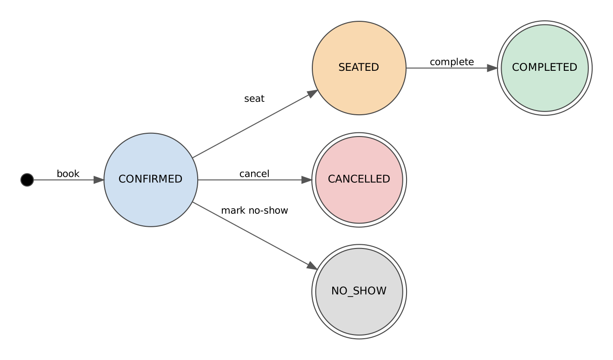
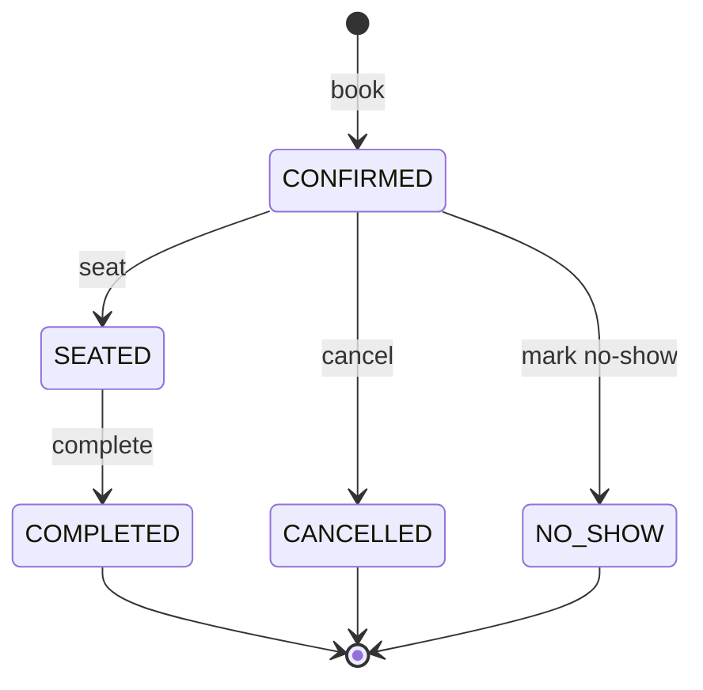

# State Transition Testing

## What it is (plain English)

Some things move through **stages**. A reservation starts as *CONFIRMED*, then the guest arrives (*SEATED*), then leaves (*COMPLETED*). It might instead be *CANCELLED* or the guest might not turn up (*NO_SHOW*).

State transition testing checks two things:
1. Every **allowed** move works (valid transitions).
2. Every **forbidden** move is blocked and the reservation stays where it was (invalid transitions). Forbidden moves are where bugs usually hide.

## State diagram

## State transition table

Rows = current state, columns = event. A state name means "moves to"; **✗** means "must be refused".

| Current state ↓ / Event → | seat | complete | cancel | no-show |
|---|---|---|---|---|
| **CONFIRMED** | SEATED (ST-01) | ✗ (ST-05) | CANCELLED (ST-03) | NO_SHOW (ST-04) |
| **SEATED** | ✗ | COMPLETED (ST-02) | ✗ (ST-06) | ✗ (ST-07) |
| **COMPLETED** | ✗ (ST-09) | ✗ | ✗ (ST-08) | ✗ |
| **CANCELLED** | ✗ (ST-10) | ✗ | ✗ (ST-11) | ✗ |
| **NO_SHOW** | ✗ (ST-12) | ✗ | ✗ (ST-13) | ✗ |

5 states × 4 events = 20 cells: 4 valid, 16 invalid. We test all 4 valid ones and 9 of the most important invalid ones (all the "cancel" and "seat" cells plus CONFIRMED→COMPLETED and SEATED→NO_SHOW), which gives **100% transition coverage** (0-switch) and covers every terminal state.

## Test cases

| TC ID | Type | Start state | Event | Expected |
|---|---|---|---|---|
| TC-ST-01 | Valid | CONFIRMED | seat | SEATED |
| TC-ST-02 | Valid | SEATED | complete | COMPLETED |
| TC-ST-03 | Valid | CONFIRMED | cancel | CANCELLED |
| TC-ST-04 | Valid | CONFIRMED | no-show | NO_SHOW |
| TC-ST-05 | Invalid | CONFIRMED | complete | Refused, stays CONFIRMED |
| TC-ST-06 | Invalid | SEATED | cancel | Refused, stays SEATED |
| TC-ST-07 | Invalid | SEATED | no-show | Refused, stays SEATED |
| TC-ST-08 | Invalid | COMPLETED | cancel | Refused, stays COMPLETED |
| TC-ST-09 | Invalid | COMPLETED | seat | Refused, stays COMPLETED |
| TC-ST-10 | Invalid | CANCELLED | seat | Refused, stays CANCELLED |
| TC-ST-11 | Invalid | CANCELLED | cancel | Refused, stays CANCELLED |
| TC-ST-12 | Invalid | NO_SHOW | seat | Refused, stays NO_SHOW |
| TC-ST-13 | Invalid | NO_SHOW | cancel | Refused, stays NO_SHOW |
| TC-ST-14 | Invalid event | CONFIRMED | "PAID" (unknown) | Refused |
| TC-ST-15 | Full path | – | book → seat → complete | COMPLETED, and table can be booked again |
| TC-ST-16 | Side effect | CONFIRMED | cancel | Table is released for a new booking |

**Automation:** `05_Test_Automation/unit/test_state_transition.py`
