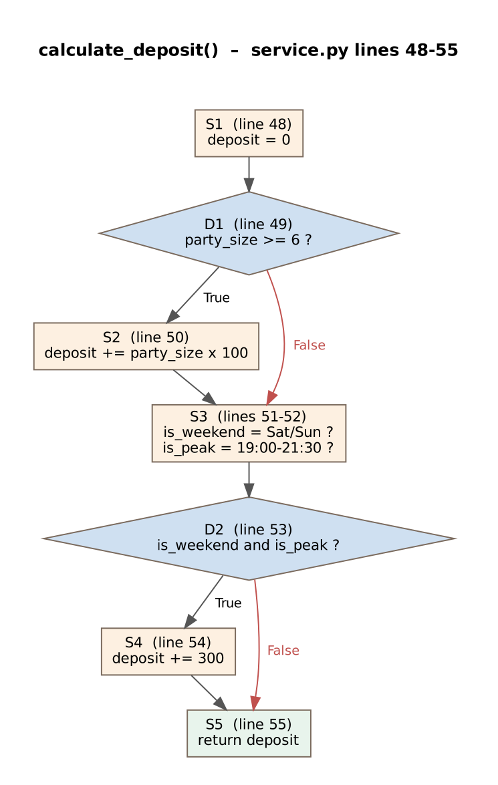
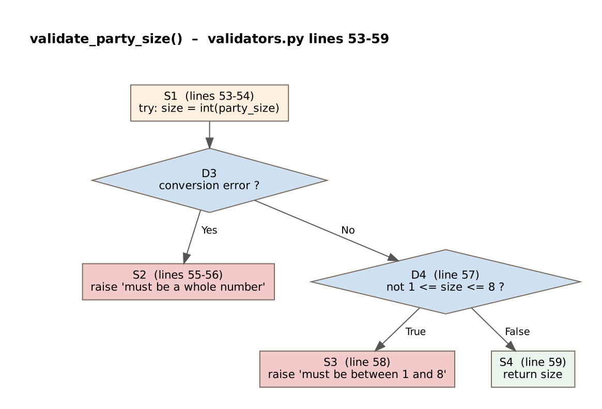

# White-Box Testing – Statement Coverage and Branch Coverage

## What it is (plain English)

In **black-box** testing (EP, BVA, decision table, state transition) we test from the **requirements**, without looking at the code. It's like checking a vending machine only by pressing buttons.

In **white-box** testing we **open the machine and look inside**. We read the code and design tests so that the inside is fully exercised:

| Method | Question it asks | Formula | Goal |
|---|---|---|---|
| **Statement coverage** | Did every line of code run at least once? | statements executed ÷ total statements × 100 | 100% |
| **Branch coverage** | Did every decision (`if`) go **both** ways – True **and** False? | branch outcomes taken ÷ total branch outcomes × 100 | 100% |

**Branch coverage is stronger.** 100% branch coverage always gives 100% statement coverage, but 100% statement coverage does **not** guarantee 100% branch coverage. Function F1 below shows this with real numbers.

**Tool:** coverage.py (through pytest-cov), which marks every line and branch our tests run.

---

## F1 – `calculate_deposit()` (service.py, lines 40–55)

```python
40  def calculate_deposit(party_size, booking_date, slot):
48      deposit = 0                                                # S1
49      if party_size >= LARGE_PARTY:                              # D1  (LARGE_PARTY = 6)
50          deposit += party_size * LARGE_PARTY_DEPOSIT_PER_GUEST  # S2  (Rs.100 per guest)
51      is_weekend = booking_date.weekday() >= SATURDAY            # S3
52      is_peak = PEAK_START <= slot <= PEAK_END                   # S3  (19:00 - 21:30)
53      if is_weekend and is_peak:                                 # D2
54          deposit += WEEKEND_PEAK_DEPOSIT                        # S4  (Rs.300)
55      return deposit                                             # S5
```

### Flow graph



8 statements, 2 decisions → **4 branch outcomes**: D1-True, D1-False, D2-True, D2-False.

### Statement coverage design

One test that makes **both** `if`s True runs every statement:

| TC ID | Input | Path | Statements run | Expected |
|---|---|---|---|---|
| TC-WB-01 | party 6, Sat 21 Nov, 19:00 | S1 → D1 T → S2 → S3 → D2 T → S4 → S5 | **8 / 8 = 100%** | Rs.900 |

But the **False** arrows (red in the graph) were never taken → branch coverage only **2 / 4 = 50%**. A bug that only happens when a condition is false would be missed.

### Branch coverage design

| Branch outcome | Taken by |
|---|---|
| D1 = True (6+ guests) | TC-WB-01 |
| D1 = False (fewer than 6) | **TC-WB-02** |
| D2 = True (weekend evening) | TC-WB-01 |
| D2 = False (not weekend evening) | **TC-WB-02** |

| TC ID | Input | Path | Expected |
|---|---|---|---|
| TC-WB-02 | party 2, Wed 18 Nov, 13:00 | S1 → D1 F → S3 → D2 F → S5 | Rs.0 |

TC-WB-01 + TC-WB-02 → **statement 100%, branch 4 / 4 = 100%**.

---

## F2 – `validate_party_size()` (validators.py, lines 51–59)

```python
51  def validate_party_size(party_size):
53      try:
54          size = int(str(party_size).strip())                    # S1
55      except (TypeError, ValueError):                            # D3  (conversion error?)
56          raise ValidationError(..., "must be a whole number")   # S2
57      if not MIN_PARTY <= size <= MAX_PARTY:                     # D4  (1 <= size <= 8)
58          raise ValidationError(..., "must be between 1 and 8")  # S3
59      return size                                                # S4
```

### Flow graph



There are **3 different paths** through this function, and each one needs its own test:

| TC ID | Input | Path | Statements newly covered | Expected |
|---|---|---|---|---|
| TC-WB-03 | `"4"` | S1 → D3 No → D4 False → S4 | lines 53, 54, 57, 59 | returns 4 |
| TC-WB-04 | `"four"` | S1 → D3 Yes → S2 | lines 55, 56 | error: whole number |
| TC-WB-05 | `9` | S1 → D3 No → D4 True → S3 | line 58 | error: between 1 and 8 |

TC-WB-03 alone: statement **4 / 7 = 57%**, branch **1 / 2 = 50%**.
TC-WB-03 + 04 + 05: statement **7 / 7 = 100%**, branch **2 / 2 = 100%**.

> coverage.py counts D4 as a branch (2 outcomes). The `try/except` (D3) is measured through its statements (lines 55–56), which TC-WB-04 covers.

### Extra: one step beyond branch coverage

D4 is a **compound condition**: `1 <= size` **and** `size <= 8`. Branch coverage is already 100% after TC-WB-05, but only the `size <= 8` part has been false. TC-WB-06 also makes `1 <= size` false. This is called **condition coverage**:

| TC ID | Input | Path | Expected |
|---|---|---|---|
| TC-WB-06 | `0` | S1 → D3 No → D4 True (lower side) → S3 | error: between 1 and 8 |

---

## Measured results

Measured per function with coverage.py by `05_Test_Automation/white_box/white_box_report.py`:

| Tests run | Function | Statement coverage | Branch coverage |
|---|---|---|---|
| TC-WB-01 only | `calculate_deposit()` | 8/8 (**100%**) | 2/4 (**50%**) |
| TC-WB-01 + TC-WB-02 | `calculate_deposit()` | 8/8 (100%) | 4/4 (**100%**) |
| TC-WB-03 only | `validate_party_size()` | 4/7 (57%) | 1/2 (50%) |
| TC-WB-03 + 04 + 05 | `validate_party_size()` | 7/7 (**100%**) | 2/2 (**100%**) |

Full results: [`06_Test_Reports/white_box/White_Box_Coverage_Results.md`](../06_Test_Reports/white_box/White_Box_Coverage_Results.md)

## Whole-application coverage

The same two measures applied to the **entire** application, using all 128 test cases (final cycle):

| | Statement coverage | Branch coverage | Combined |
|---|---|---|---|
| Whole application | **94%** | **86%** | **93%** |

Report: `06_Test_Reports/cycle3/coverage/index.html` (green lines = run by a test, red = never run).

## If asked: cyclomatic complexity

Cyclomatic complexity V(G) = number of decisions + 1 = the number of independent paths through a function.
- `calculate_deposit()`: 2 decisions → V(G) = **3**
- `validate_party_size()`: 2 decisions → V(G) = **3** (matching the 3 paths tested by TC-WB-03, 04, 05)

## How to run

```bash
bash demo.sh wb
```

This runs TC-WB-01 … 06 and prints the step-by-step coverage table above.

**Automation:** `05_Test_Automation/white_box/test_white_box.py`
