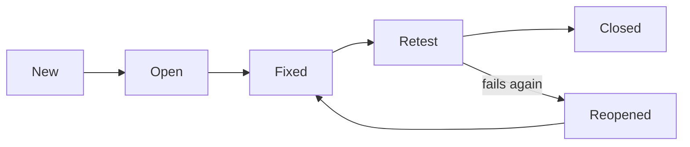

# Defect Log – Restaurant Table Reservation System

**9 defects** found in build v1.0.0. All open, assigned for fixing.

## Defects by severity

| Severity | Count |
|---|---:|
| Critical | 1 |
| High | 2 |
| Medium | 4 |
| Low | 2 |
| **Total** | **9** |

## Defect list

| ID | Title | Severity | Priority | Module | Found by | Status |
|---|---|---|---|---|---|---|
| [DEF-001](DEF-001.md) | Party of 8 guests is rejected although 8 is allowed | High | P1 | M1 Input validation | TC-BVA-05, PM-06 | Open |
| [DEF-002](DEF-002.md) | Phone numbers longer than 10 digits are accepted | Medium | P2 | M1 Input validation | TC-EP-10, TC-BVA-16 | Open |
| [DEF-003](DEF-003.md) | Double booking: a booking that starts earlier and runs into an existing one is accepted | Critical | P1 | M2 Table allocation | TC-BVA-30, TC-BVA-31, PM-08 | Open |
| [DEF-004](DEF-004.md) | Friday evening bookings are charged the weekend deposit | Medium | P2 | M3 Deposit | TC-DT-09 | Open |
| [DEF-005](DEF-005.md) | Seated and completed reservations can be cancelled | High | P1 | M4 Life cycle / M5 Cancellation | TC-ST-06, TC-ST-08, TC-DT-16, PM-12 | Open |
| [DEF-006](DEF-006.md) | Names made only of spaces (or one letter padded with spaces) are accepted | Medium | P2 | M1 Input validation | TC-EP-05, TC-BVA-13 | Open |
| [DEF-007](DEF-007.md) | Bookings are accepted 31 days in advance (limit is 30) | Low | P3 | M1 Input validation | TC-BVA-22 | Open |
| [DEF-008](DEF-008.md) | Booking form clears everything the user typed after a validation error | Medium | P2 | M8 Web UI | TC-UI-04 | Open |
| [DEF-009](DEF-009.md) | Staff view: Actions column breaks the table row border | Low | P4 | M8 Web UI | Exploratory (screenshot review) | Open |

## Which technique found which defect

| Technique | Defects found |
|---|---|
| Boundary Value Analysis | DEF-001, DEF-002, DEF-003, DEF-006, DEF-007 |
| Equivalence Partitioning | DEF-002, DEF-006 |
| Decision Table | DEF-004, DEF-005 |
| State Transition | DEF-005 |
| Selenium UI test | DEF-008 |
| Postman / Newman | DEF-001, DEF-003, DEF-005 |
| Exploratory review of screenshots | DEF-009 |

BVA found the most defects – 5 of the 9 were off-by-one or edge mistakes (`<` vs `<=`, `+1`, unanchored regex, interval overlap).

## Defect life cycle used

## Severity scale

| Severity | Meaning |
|---|---|
| Critical | Core function broken or wrong data (e.g. double booking) |
| High | Important rule broken, no easy workaround |
| Medium | Rule broken, workaround exists |
| Low | Cosmetic or minor |
