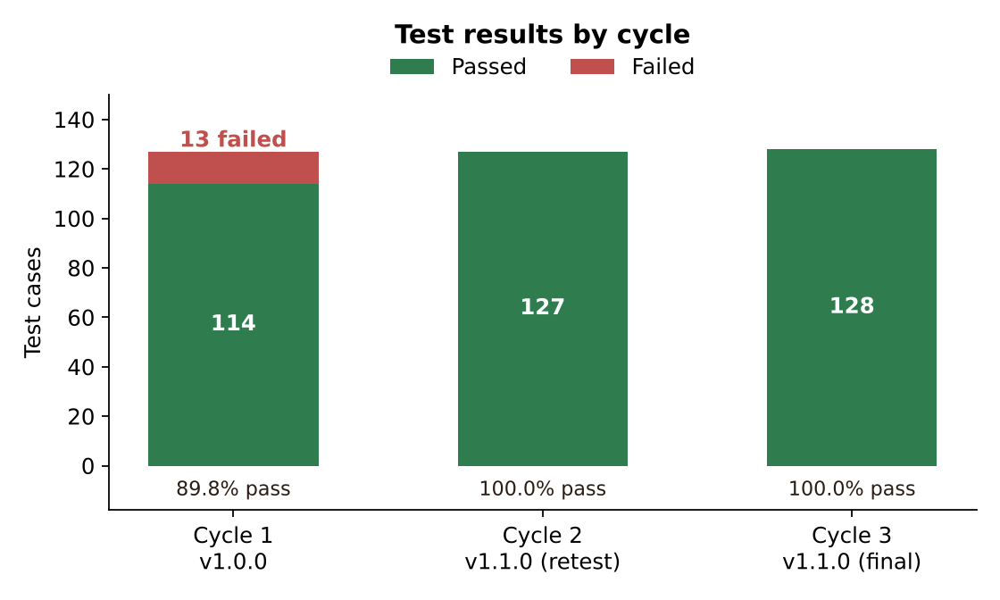
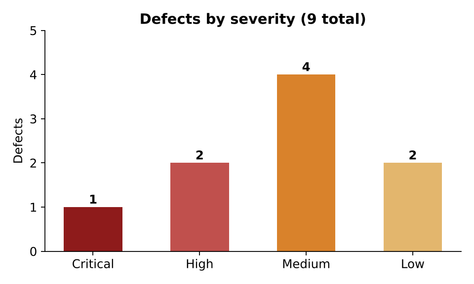
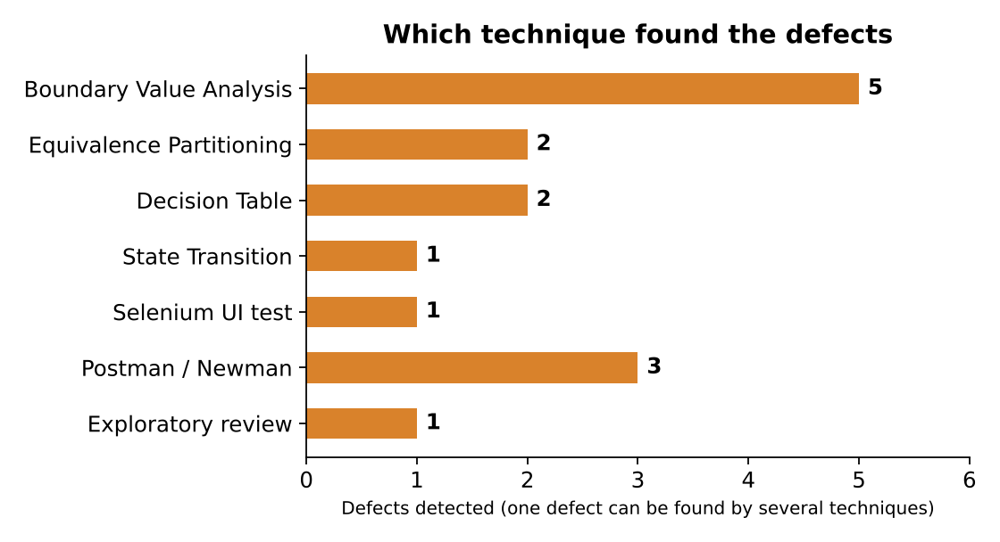
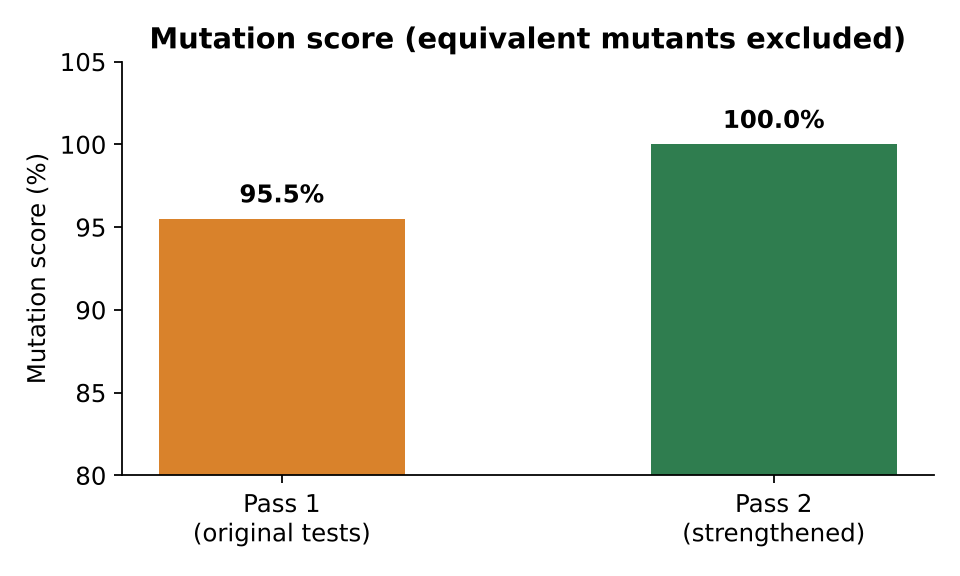

# Test Summary Report – Restaurant Table Reservation System

| Item | Detail |
|---|---|
| Document ID | TSR-RTRS-01 |
| Application | Restaurant Table Reservation System ("The Saffron Table") |
| Builds tested | v1.0.0 (Cycle 1) → v1.1.0 (Cycles 2 and 3) |
| Prepared by | Roshna Sai (1MS23IS106) |
| Related documents | [Test Plan](../01_Test_Plan/Test_Plan.md) · [Test Case Design](../02_Test_Case_Design/README.md) · [Defect Log](../04_Defect_Reports/Defect_Log.md) |

> A PDF version of this report is in this folder: **Test_Summary_Report.pdf**

## 1. Summary in one paragraph

We tested the reservation system with **128 designed test cases** (4 design techniques plus API and UI scenarios), a **15-request Postman collection** and **mutation testing**. The first cycle on build v1.0.0 found **9 defects**, including one **critical double-booking bug**. All 9 were fixed in v1.1.0 and **closed after retest**. The final regression passed **128/128** test cases and **31/31** Postman assertions, with **93% code coverage** and a **100% mutation score**. All exit criteria in the test plan are met, and the build is **recommended for release**.

## 2. Test execution results

| Cycle | Build | Executed | Passed | Failed | Pass rate | Postman assertions | Log |
|---|---|---:|---:|---:|---:|---|---|
| 1 – first run | v1.0.0 | 127 | 114 | 13 | 89.8% | 25 / 31 | [Cycle 1](../03_Test_Execution/Cycle_1_Execution_Log.md) |
| 2 – retest + regression | v1.1.0 | 127 | 127 | 0 | 100% | 31 / 31 | [Cycle 2](../03_Test_Execution/Cycle_2_Execution_Log.md) |
| 3 – final regression (after mutation testing) | v1.1.0 | 128 | 128 | 0 | 100% | 31 / 31 | [Cycle 3](../03_Test_Execution/Cycle_3_Execution_Log.md) |

### By technique (Cycle 1 → Cycle 3)

| Technique | Test cases | Cycle 1 failed | Cycle 3 failed |
|---|---:|---:|---:|
| Equivalence Partitioning | 29 | 2 | 0 |
| Boundary Value Analysis | 38 | 6 | 0 |
| Decision Table | 17 | 2 | 0 |
| State Transition | 16 | 2 | 0 |
| Table Allocation | 7 | 0 | 0 |
| REST API (pytest) | 13 | 0 | 0 |
| Web UI (Selenium) | 8 | 1 | 0 |
| **Total** | **128** | **13** | **0** |

TC-BVA-38 was added after Cycle 2 (see section 5), so Cycles 1 and 2 ran 127 test cases.

## 3. Defects

| ID | Defect | Severity | Found by | Status |
|---|---|---|---|---|
| DEF-001 | Party of 8 rejected | High | BVA, Postman | Closed |
| DEF-002 | 11+ digit phone accepted | Medium | EP, BVA | Closed |
| DEF-003 | **Double booking** of a table | **Critical** | BVA, Postman | Closed |
| DEF-004 | Friday charged weekend deposit | Medium | Decision table | Closed |
| DEF-005 | Seated/completed bookings can be cancelled | High | State transition, decision table, Postman | Closed |
| DEF-006 | Blank (spaces-only) name accepted | Medium | EP, BVA | Closed |
| DEF-007 | Booking 31 days ahead accepted | Low | BVA | Closed |
| DEF-008 | Form clears input after an error | Medium | Selenium | Closed |
| DEF-009 | Staff table border broken (cosmetic) | Low | Exploratory screenshot review | Closed |

**Defect density:** 9 defects in 352 statements of application code ≈ 2.6 defects per 100 statements in v1.0.0, and 0 known open defects in v1.1.0.

## 4. Code coverage (Cycle 3)

| Module | Statement + branch coverage |
|---|---:|
| `models.py` | 100% |
| `service.py` (booking engine) | 99% |
| `validators.py` | 95% |
| `web.py` | 87% |
| `api.py` | 85% |
| `__init__.py` | 81% |
| **Total** | **93%** |

The uncovered lines are start-up code that reads environment variables, the test-only `/api/_reset` endpoint, and a few error branches for malformed input (a missing name field, a badly formatted time, or a bad date in the list filter). None of them change a business rule. These are good candidates for future tests. HTML report: `cycle3/coverage/index.html`.

## 5. Mutation testing

71 mutants were generated in `validators.py` and `service.py`. The first pass killed 64. Of the 7 survivors, **4 were equivalent** and **3 showed weak tests**. We strengthened TC-BVA-01/06 and TC-API-12 and added TC-BVA-38, which raised the mutation score from **95.5% to 100%**. Details: [Mutation_Testing_Report.md](Mutation_Testing_Report.md).

## 6. Exit criteria check

| Exit criterion (from test plan) | Target | Actual | Met? |
|---|---|---|---|
| Planned test cases executed | 100% | 128 / 128 | ✅ |
| Critical and High defects fixed and retested | All | 3 / 3 closed | ✅ |
| Pass rate in final regression | ≥ 95% | 100% | ✅ |
| Coverage of business-logic modules | ≥ 90% | service 99%, validators 95% | ✅ |
| Test summary report prepared | Yes | This document | ✅ |

## 7. Tools used

pytest 9 · pytest-html · pytest-cov · Selenium 4 + headless Chrome · Postman collection run with Newman 6 · a custom AST mutation tool · Graphviz and matplotlib for diagrams/charts · Git and GitHub for version control.

## 8. Lessons learned

1. **Boundaries are where bugs live.** 5 of 9 defects were off-by-one or edge mistakes, and BVA found all of them.
2. **Overlap logic needs both directions.** The critical double-booking bug only showed up when the new booking started *before* the existing one (TC-BVA-30/31).
3. **Test forbidden moves, not just allowed ones.** State-transition testing of invalid transitions found DEF-005.
4. **Freeze the clock.** A fixed "now" made every date-based test give the same result on any day.
5. **Flaky UI tests come from timing.** Waiting for the old page element to go stale fixed intermittent Selenium failures.
6. **Coverage is not enough.** 99% coverage still left 3 weak assertions that only mutation testing exposed.

## 9. Recommendation

Build **v1.1.0 is recommended for release**. For future work: add data persistence (database) with its own tests, load testing (e.g. JMeter or Locust) for peak hours, and security testing of the API.
