# Screenshots

## Application under test (Selenium, cycle 3 – build v1.1.0)

| Test | Screenshot |
|---|---|
| TC-UI-01 Home page / booking form | 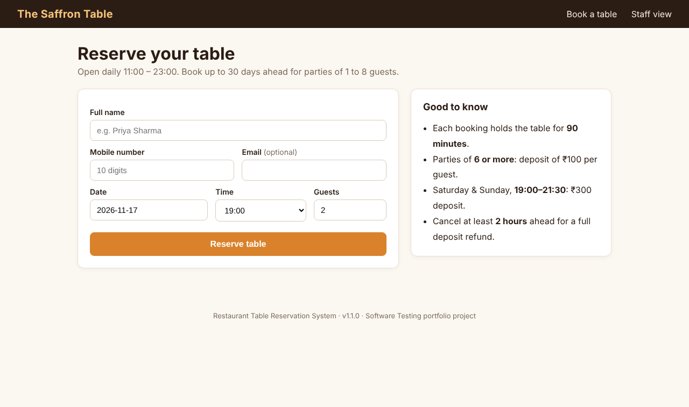 |
| TC-UI-02 Booking confirmed | 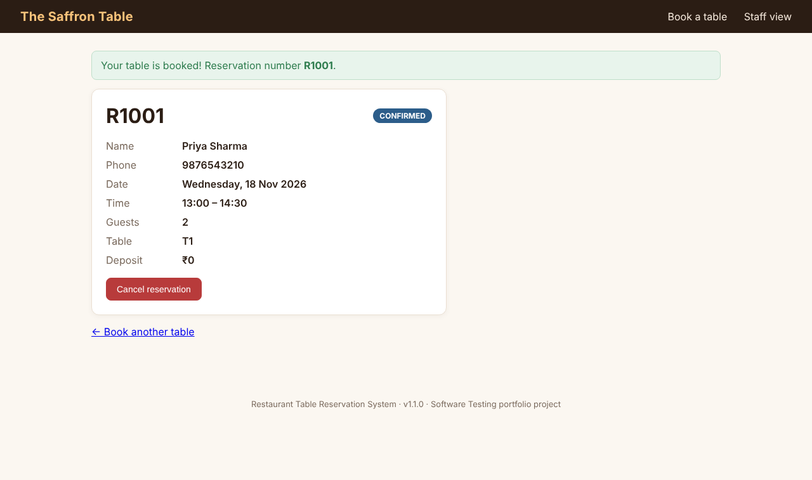 |
| TC-UI-03 Invalid phone error | 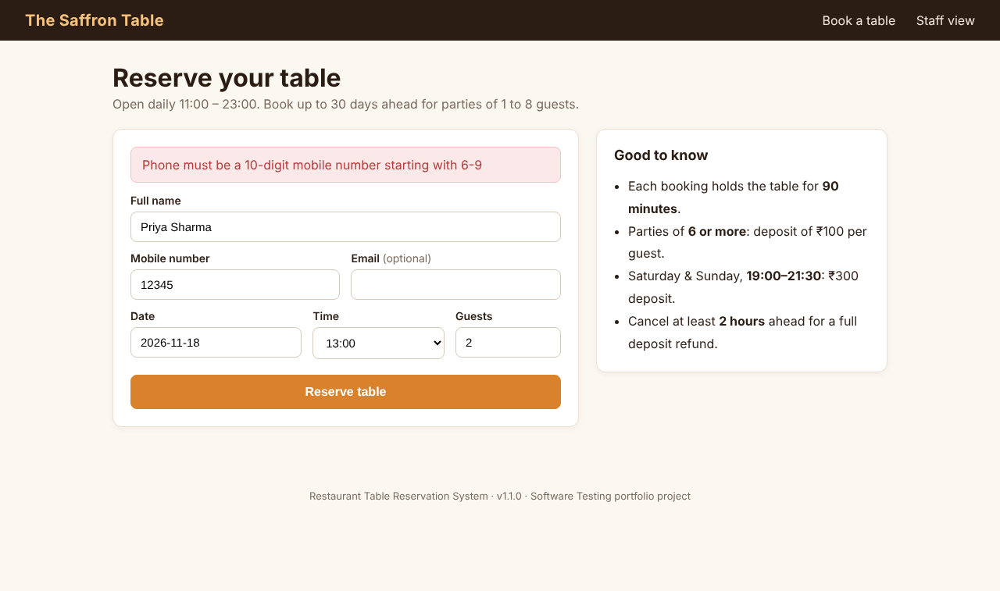 |
| TC-UI-05 Reservation cancelled with refund | 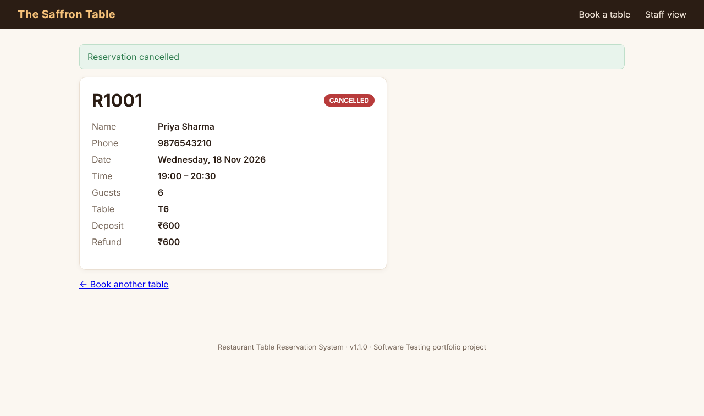 |
| TC-UI-06 Staff view – seated / completed |  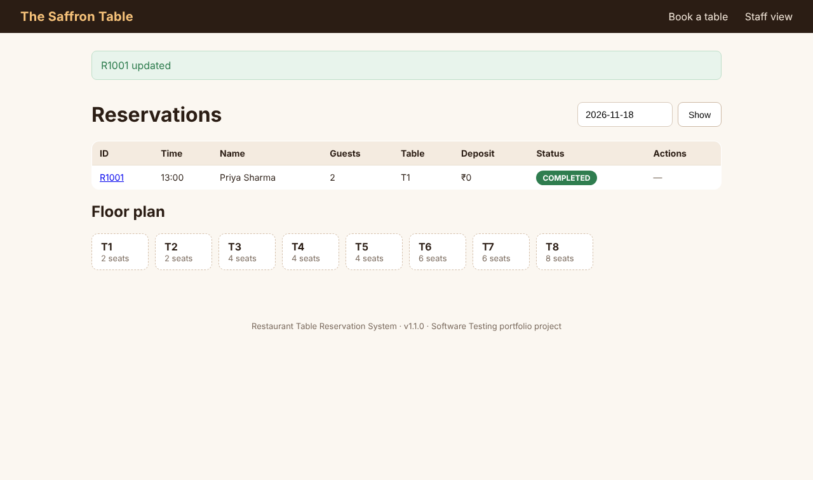 |
| TC-UI-07 Weekend peak deposit ₹900 |  |
| TC-UI-08 Unknown reservation | 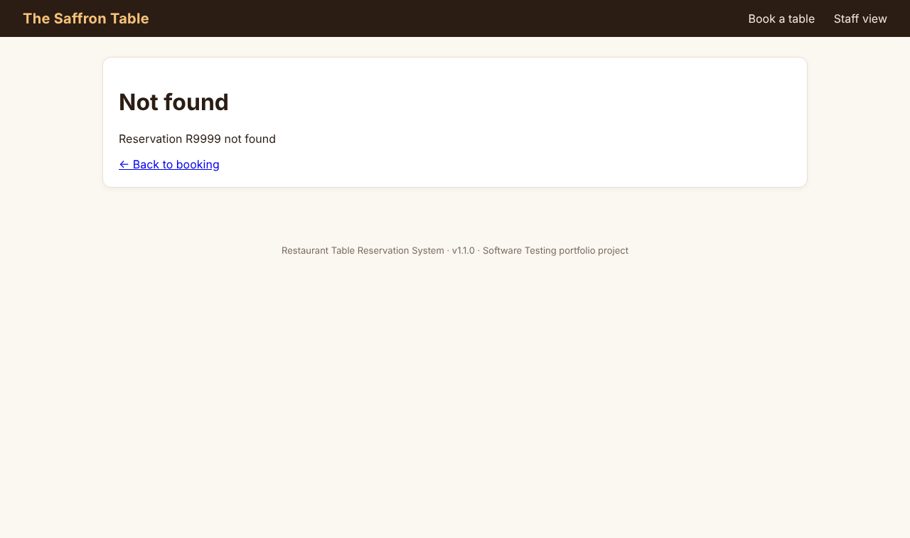 |

## Defect evidence – before and after the fix

| Defect | Cycle 1 (v1.0.0 – bug) | Cycle 2 (v1.1.0 – fixed) |
|---|---|---|
| DEF-008 Form loses input after error |  |  |
| DEF-009 Staff table border | 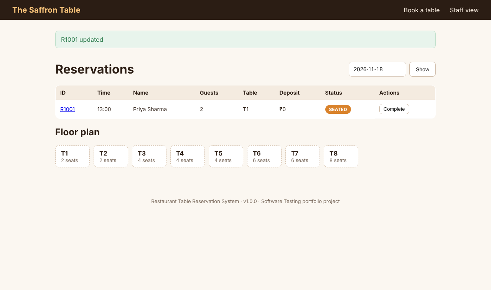 |  |

## Test reports

| Report | Cycle 1 (v1.0.0) | Cycle 3 (v1.1.0) |
|---|---|---|
| pytest console | 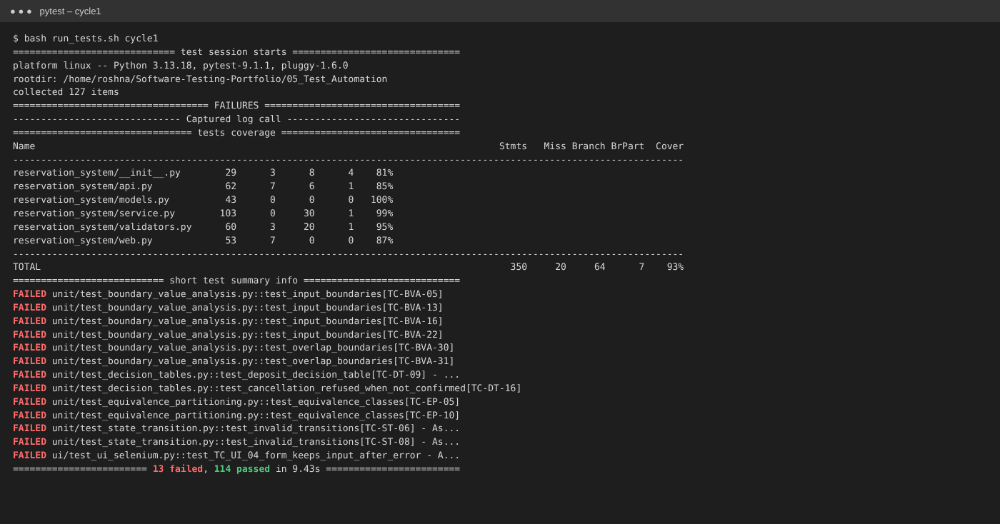 | 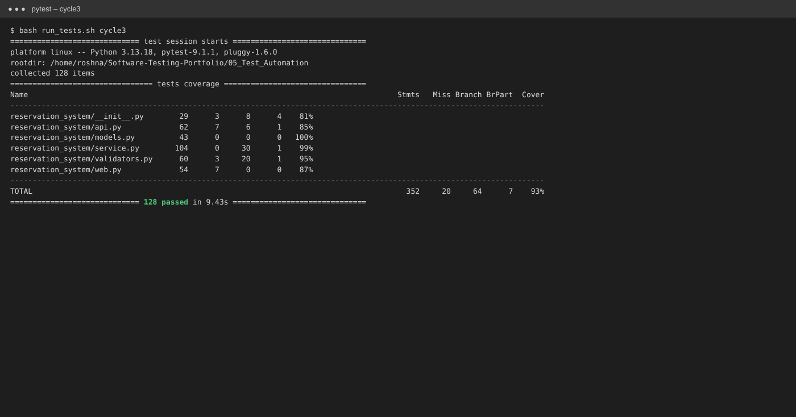 |
| pytest-html report | 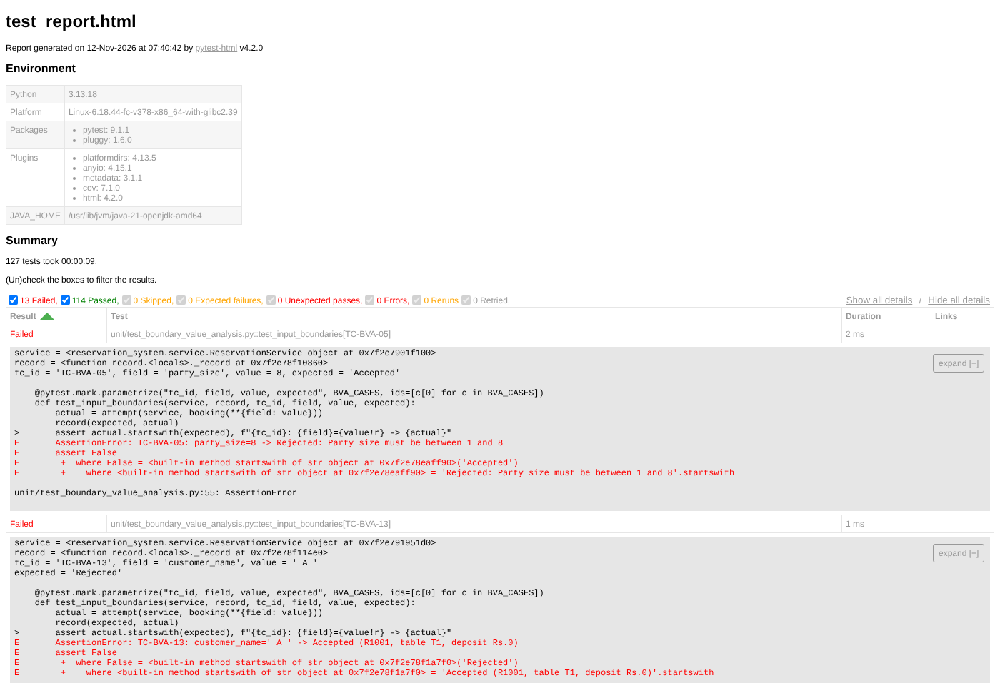 | 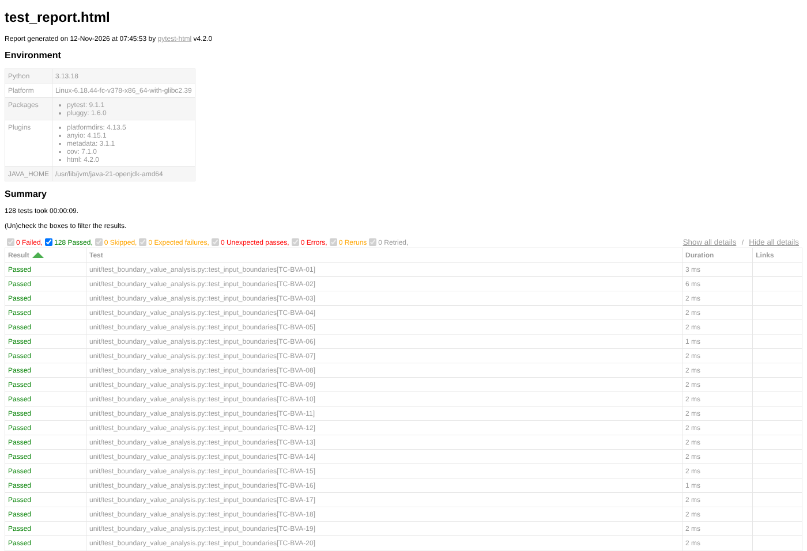 |
| Coverage report | 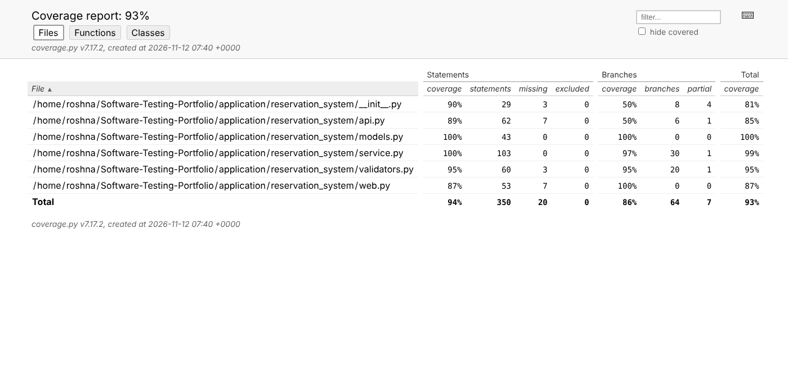 |  |
| Newman (Postman) | 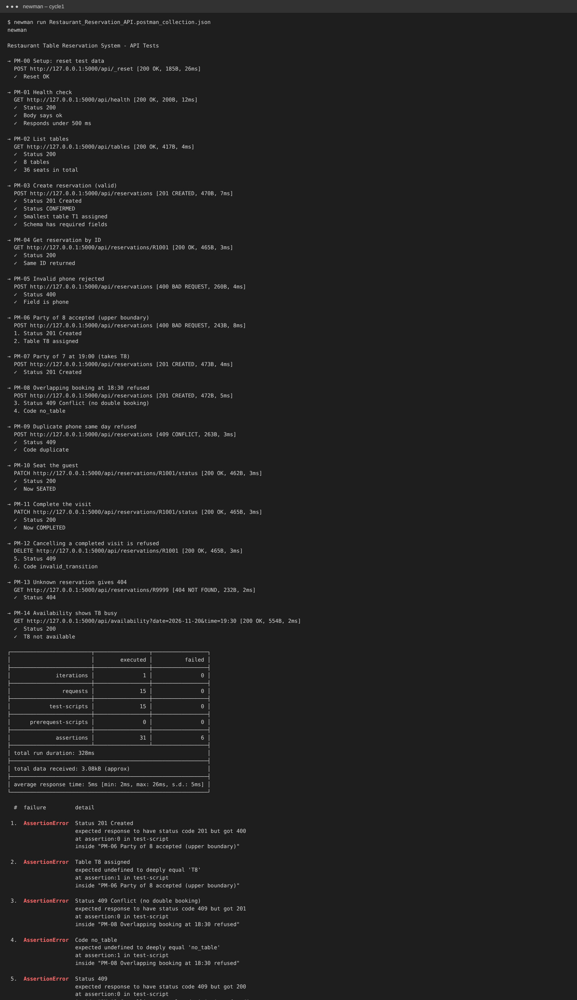 | 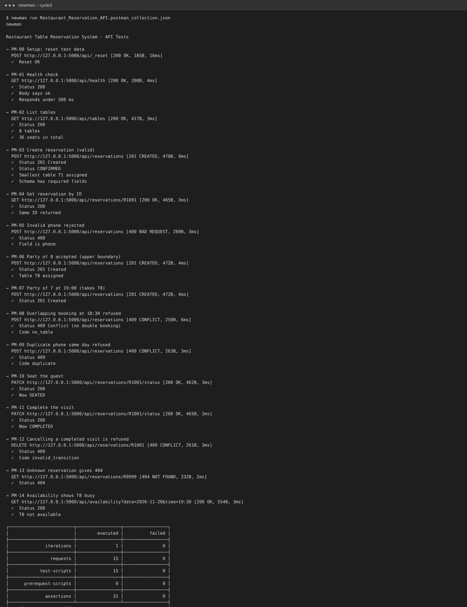 |

## Diagrams

Architecture and state-transition diagrams: [`01_Test_Plan/diagrams/`](../01_Test_Plan/diagrams/)
