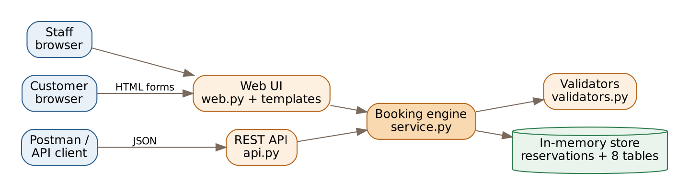
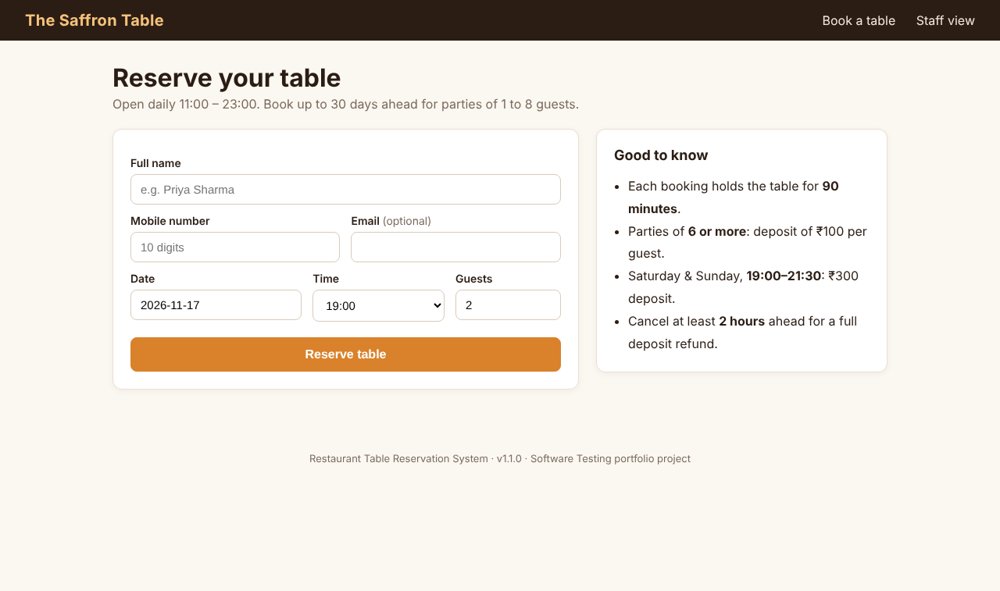
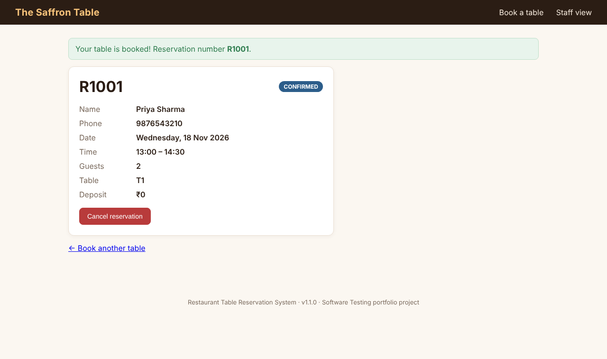
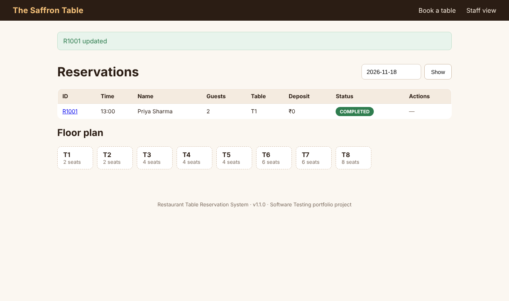
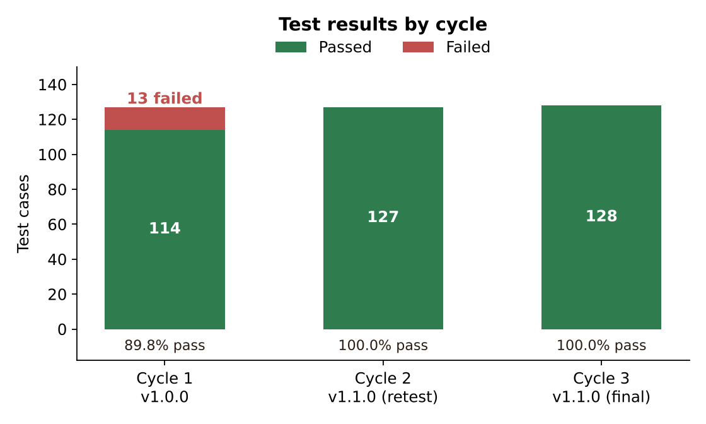

# Software Testing Portfolio – Restaurant Table Reservation System

    

## Student details

| Name | USN |
|---|---|
| Roshna Sai | 1MS23IS106 |
| Vishwajith Chakravarthy | 1MS23IS150 |
| Yashaswini | 1MS23IS107 |

| | |
|---|---|
| **Department** | Information Science & Engineering |
| **Institution** | M S Ramaiah Institute of Technology, Bengaluru |
| **Subject** | Software Testing – Other Component (Online Portfolio using GitHub Activity) |
| **Application assigned** | Restaurant Table Reservation System |

## Objectives

1. Understand a real application and identify the modules and functionalities to be tested.
2. Prepare a test plan with scope, approach, environment, and entry and exit criteria.
3. Design test cases using **Equivalence Partitioning, Boundary Value Analysis, Decision Tables and State Transition** testing.
4. Execute the test cases, record actual results, and identify and document defects.
5. Automate testing with **pytest, Selenium WebDriver, Postman/Newman** and **mutation testing**.
6. Prepare a test execution summary and keep the whole portfolio on GitHub with meaningful commits.

## Project description

**The Saffron Table** is a small restaurant with 8 tables (36 seats). Its web application lets:

* **customers** book a table online (name, mobile, guests, date, time), see the confirmation and cancel it;
* **staff** see the day's bookings and mark guests as *seated*, *completed* or *no-show*.

The system picks the smallest free table that fits the group. It holds the table for 90 minutes, must never double-book a table, and charges a deposit for large groups and weekend evenings. These rules (R1–R13 in the [test plan](01_Test_Plan/Test_Plan.md)) are what we tested.

The application was built in Python (Flask) for this project and lives in [`application/`](application/). **Build v1.0.0** was tested first. The defects found were fixed in **build v1.1.0**, which was then retested.



| Booking form | Confirmation | Staff view |
|---|---|---|
|  |  |  |

## Results at a glance

| Metric | Result |
|---|---|
| Test cases designed | **128** (EP 29 · BVA 38 · Decision table 17 · State transition 16 · Allocation 7 · API 13 · UI 8) |
| Postman requests | 15 requests · 31 assertions |
| Defects found in v1.0.0 | **9** (1 Critical, 2 High, 4 Medium, 2 Low), including a **double-booking** bug |
| Defects open in v1.1.0 | **0** – all fixed and closed after retest |
| Final regression | **128 / 128 passed**, Newman **31 / 31** |
| Code coverage | **93%** (service 99%, validators 95%) |
| Mutation score | 95.5% → **100%** after strengthening 3 tests |



## Repository structure

| Folder | What's inside |
|---|---|
| [`application/`](application/) | The system under test (Flask app, REST API, web UI) |
| [`01_Test_Plan/`](01_Test_Plan/Test_Plan.md) | Test plan: requirements, modules, scope, approach, environment, criteria, risks, diagrams |
| [`02_Test_Case_Design/`](02_Test_Case_Design/README.md) | EP, BVA, decision tables, state transition, scenario test cases and the traceability matrix |
| [`03_Test_Execution/`](03_Test_Execution/README.md) | Execution logs for 3 cycles: expected vs actual result for every test case (Markdown + CSV) |
| [`04_Defect_Reports/`](04_Defect_Reports/Defect_Log.md) | Defect log and one detailed report per defect (DEF-001 … DEF-009) |
| [`05_Test_Automation/`](05_Test_Automation/README.md) | pytest unit/API tests, Selenium UI tests, Postman collection, mutation testing tool |
| [`06_Test_Reports/`](06_Test_Reports/README.md) | Test summary report (PDF + Markdown), HTML test and coverage reports, Newman and mutation reports |
| [`07_Screenshots/`](07_Screenshots/README.md) | Selenium screenshots (cycles 1–3) and screenshots of the reports |
| [`Conclusion.md`](Conclusion.md) | What we did, what we found, what we learned |

## Testing techniques used

| Technique | Applied to | Defects it found |
|---|---|---|
| Equivalence Partitioning | Name, phone, email, guests, date, time, duplicates | DEF-002, DEF-006 |
| Boundary Value Analysis | Guests 1–8, name 2–50, phone length, 30-day window, 11:00–21:30, 90-min overlap, 2-h refund | DEF-001, 002, 003, 006, 007 |
| Decision Table | Deposit rule (8 rules), cancellation and refund | DEF-004, DEF-005 |
| State Transition | Reservation life cycle (5 states, 4 events) | DEF-005 |
| Selenium WebDriver | Booking, cancellation and staff flows in Chrome | DEF-008 |
| Postman / Newman | REST API contract | DEF-001, 003, 005 |
| Mutation testing | Quality of the test suite itself | 3 weak tests improved |

## How to run

```bash
# 1. Install
pip install -r application/requirements.txt -r 05_Test_Automation/requirements.txt
npm install -g newman                       # for the Postman collection

# 2. Start the application
cd application && python run.py             # http://127.0.0.1:5000

# 3. Run a full test cycle (pytest + Selenium + Newman + execution log)
bash 05_Test_Automation/run_tests.sh cycle3 "Cycle 3"

# 4. Mutation testing
cd 05_Test_Automation && python mutation/mutation_test.py
```

Selenium needs Google Chrome. Selenium Manager downloads a matching driver automatically, or you can point `CHROMEDRIVER` at one.

## How the work progressed (commit history)

The commit history follows the testing life cycle:

1. Repository structure → application v1.0.0
2. Test plan → test case design
3. Automation: pytest → Selenium → Postman → cycle runner
4. **Cycle 1** on v1.0.0: 13 failures
5. **9 defects logged**
6. **One commit per fix** (`Fix DEF-001` … `Fix DEF-009`) → release v1.1.0
7. **Cycle 2** retest + regression: all pass → defects closed
8. Mutation testing → 3 tests strengthened
9. **Cycle 3** final regression → summary report and conclusion

## Tools

Python 3 · Flask · pytest · pytest-html · pytest-cov · Selenium 4 · Google Chrome (headless) · Postman · Newman · Graphviz · matplotlib · ReportLab · Git and GitHub
